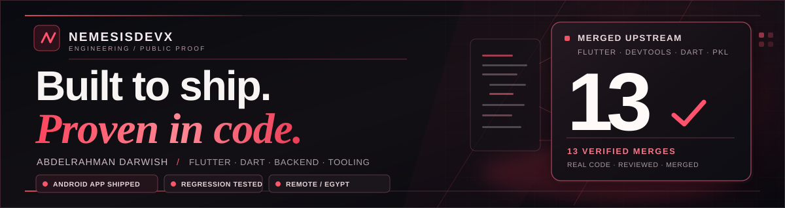

  

  <h1>Abdelrahman Darwish · NemesisDevX</h1>
  
<strong>Flutter / Dart · Developer Tooling · Backend Engineering</strong>

  
Independent developer in Egypt. <strong>13 engineering pull requests merged upstream</strong> across five public repositories: Flutter, Dart-Code, Flutter DevTools, Dart tooling, and Apple-maintained Pkl Neovim. Real fixes, regression tests and external maintainer reviews. One published Flutter Android app.

  

    <a href="https://nemesisdevx.github.io/"><strong>PORTFOLIO ↗</strong></a> &nbsp;·&nbsp;
    <a href="https://nemesisdevx.github.io/work.html"><strong>CASE STUDIES ↗</strong></a> &nbsp;·&nbsp;
    <a href="https://nemesisdevx.github.io/assets/Abdelrahman_Darwish_Engineering_CV_2026.pdf"><strong>RESUME (PDF) ↗</strong></a> &nbsp;·&nbsp;
    <a href="https://play.google.com/store/apps/details?id=com.tasbehati.ai.pr"><strong>ANDROID APP ↗</strong></a> &nbsp;·&nbsp;
    <a href="mailto:abdelrhmanmahrous386@gmail.com"><strong>EMAIL ↗</strong></a>
  

  
Available for paid remote engineering roles and contracts. Open-source contributions do not imply employment with upstream organizations.

---

### Featured engineering work · Start here

**01 — [Dart-Code DTD WebSocket reliability](https://github.com/Dart-Code/Dart-Code/pull/6367)** · Settled pending requests on disconnect and disposal; guarded sends to sockets that are not OPEN, with lifecycle regressions.

**02 — [Flutter Web accessibility](https://github.com/flutter/flutter/pull/195564)** · Corrected initial slider value/range semantics when re-enabling a disabled control. Merged into Flutter's web engine after review.

**03 — [Dart-Code Test Explorer and auto invocation](https://github.com/Dart-Code/Dart-Code/pull/6422)** · Removed helper-defined phantom tests while preserving CodeLens and correct test invocation. Reproduced the issue, tested before and after, reviewed with DanTup, and merged.

**04 — [Flutter DevTools responsive Network UI](https://github.com/flutter/devtools/pull/10057)** · Repaired narrow-screen toolbar and footer overflow, keeping search, filters and actions available. Approved by srawlins and merged.

**05 — [Dart Tools unified analytics API](https://github.com/dart-lang/tools/pull/2806)** · Added fallbackRootTool support to environment resolution, tested precedence and contract cases, and incorporated keertip's review.

Featured by engineering impact, reviewer evidence and relevance to developer tooling — not by date or size. Contributions do not imply employment with upstream maintainers.

---

## Merged upstream · 13 verified engineering PRs

**Verified on 12 November 2026:** 13 upstream engineering PRs merged across five public repositories. Links open the actual code, discussion and merge record. Ranked subjectively by technical depth, downstream impact and regression evidence — not merge date.

| Rank | Upstream contribution | Problem solved |
| :---: | :--- | :--- |
| **01** | [Dart-Code #6367 · DTD socket reliability](https://github.com/Dart-Code/Dart-Code/pull/6367) | Reject abandoned requests; handle disconnect/disposal and non-OPEN socket states |
| **02** | [Flutter #195564 · Web accessibility](https://github.com/flutter/flutter/pull/195564) | Correct slider accessibility values and range upon re-enabling |
| **03** | [Dart-Code #6422 · Test Explorer](https://github.com/Dart-Code/Dart-Code/pull/6422) | Eliminate phantom helper tests; preserve CodeLens; correct line/name auto invocation |
| **04** | [Flutter DevTools #10057 · Responsive UI](https://github.com/flutter/devtools/pull/10057) | Fix Network toolbar and shared footer overflow at narrow widths |
| **05** | [Dart-Code #6349 · DTD disposal lifecycle](https://github.com/Dart-Code/Dart-Code/pull/6349) | Prevent async callbacks and subscriptions outliving VS Code extension disposal |
| **06** | [Dart Tools #2806 · Analytics fallback](https://github.com/dart-lang/tools/pull/2806) | Handle missing/invalid DASH__TOOL using fallbackRootTool with precedence tests |
| **07** | [Dart-Code #6301 · Hidden workspaces](https://github.com/Dart-Code/Dart-Code/pull/6301) | Restore test filters and pubspec handling beneath hidden parent directories |
| **08** | [Apple pkl-neovim #75 · LSP configuration](https://github.com/apple/pkl-neovim/pull/75) | Send settings as nested tables expected by Neovim configuration lookup |
| **09** | [Dart-Code #6388 · Dynamic node matching](https://github.com/Dart-Code/Dart-Code/pull/6388) | Match test nodes by kind and full name without absorbing unrelated siblings |
| **10** | [Dart-Code #6373 · Deterministic CI](https://github.com/Dart-Code/Dart-Code/pull/6373) | Stub real tool processes and network in command tests; one local group ~24s → ~3s |
| **11** | [Dart-Code #6337 · SDK search testing](https://github.com/Dart-Code/Dart-Code/pull/6337) | Verify search precedence across Flutter, Fuchsia and PATH SDK candidates |
| **12** | [Dart-Code #6332 · Package command testing](https://github.com/Dart-Code/Dart-Code/pull/6332) | Add package-command and pubspec watcher regression coverage |
| **13** | [Dart-Code #6324 · Project creation tests](https://github.com/Dart-Code/Dart-Code/pull/6324) | Cover template selection, SDK config, cancellation, validation and error paths |

Engineering PRs only. An additional merged entry in a curated AI-apps directory is intentionally excluded. Open, approved or pending PRs are also excluded. AI assistance was disclosed to reviewers where applicable; upstream commits and reviews are independently verifiable.

## Engineering case studies — five merged, two human-approved but still open

| Root cause / user impact | Fix and verification | Public evidence |
| :--- | :--- | :--- |
| **Dart-Code Test Explorer:** helper-defined tests appeared as phantom root-level nodes, inflating 6/6 real tests into 6/9 displayed. | Limit static discovery to top-level main(), preserve helper CodeLens and line-mode execution; executable regressions and before/after evidence; merged **12 Nov 2026**. | [#6422](https://github.com/Dart-Code/Dart-Code/pull/6422) |
| **Flutter DevTools Network:** narrow screens could crowd search/filter controls and footer actions. | Responsive layout and overflow menu preserving callbacks, with widget regressions; approved by srawlins and merged **12 Nov 2026**. | [#10057](https://github.com/flutter/devtools/pull/10057) |
| **Dart Tools analytics:** shared components could not cleanly propagate their root tool when DASH__TOOL was absent or invalid. | Add fallbackRootTool to environment resolution with precedence/contract tests; approved by keertip and merged **12 Nov 2026**. | [#2806](https://github.com/dart-lang/tools/pull/2806) |
| **Dart-Code DTD WebSockets:** pending RPCs hung on disconnect and sends could target closed/connecting sockets. | Settle outstanding requests, guard socket state, handle shutdown races; approved and merged **9 Nov 2026**. | [#6367](https://github.com/Dart-Code/Dart-Code/pull/6367) |
| **Flutter Web slider accessibility:** newly enabled slider roles could expose incorrect initial values to screen readers. | Initialize semantics values at role attachment; focused regression and upstream review; merged **4 Nov 2026**. | [#195564](https://github.com/flutter/flutter/pull/195564) |
| **Flutter Web scroll semantics (approved; not merged):** stale offsets could activate the wrong list row after a list shrank. | Corrected scroll semantics with reviewer-validated [before](https://flutter-demo-93-before.web.app) / [after](https://flutter-demo-93-after.web.app) demos. | [#195578 · open](https://github.com/flutter/flutter/pull/195578) |
| **Dart pool timeouts (approved; not merged):** pending resource requests could stop timing out on repeated attempts. | Restore repeatable timeout behavior and cover it in tests; awaiting maintainer merge. | [#2763 · open](https://github.com/dart-lang/tools/pull/2763) |

**My workflow:** reproduce a real failure → add focused regression coverage → fix the smallest safe path → run executable tests and static checks → address maintainer review. This is also how I approach Flutter apps and backend APIs.

[Explore NEMESIS / Engineering →](https://nemesisdevx.github.io/) · [Full case studies](https://nemesisdevx.github.io/work.html#case-studies)

## Shipped software

### [Tasbehati / تسبيحاتي](https://play.google.com/store/apps/details?id=com.tasbehati.ai.pr)

A **published Flutter Android application** for Quran reading, adhkar, tasbih, prayer times, and daily spiritual tools. Built and maintained with practical experience in production debugging, Firebase, mobile release engineering, and monetization.

**Production evidence:** [Open Tasbehati on Google Play](https://play.google.com/store/apps/details?id=com.tasbehati.ai.pr) · Android production release · Source is private.

| Engineering strengths | Real-world scope |
| :--- | :--- |
| **Mobile delivery** | Android app release and ongoing maintenance |
| **Debugging & reliability** | Crash fixes, regression analysis, and UI behavior |
| **Integrations** | Firebase, REST APIs, and mobile ads |
| **Testing** | Focused regressions, release checks, and device validation |

## Current upstream review queue

**Snapshot as of 12 November 2026.** This is a short list of still-open work — separate from the thirteen verified upstream merges.

| Status | Pull request |
| :--- | :--- |
| **Human-approved · open** | [Flutter #195578 — scrolling semantics](https://github.com/flutter/flutter/pull/195578) |
| **Human-approved · open** | [dart-lang/tools #2763 — pool timeouts](https://github.com/dart-lang/tools/pull/2763) |
| **Under review · open** | [flutter/core-packages #49 — multicast_dns IPv4 interfaces](https://github.com/flutter/core-packages/pull/49) |
| **Under review · open** | [flutter/devtools #10063 — extension build-size optimization](https://github.com/flutter/devtools/pull/10063) |

[Browse the full open PR list](https://github.com/pulls?q=is%3Apr+author%3ANemesisDevX+is%3Aopen) · An approval or green CI is **not** a merge.

## Selected engineering projects

| Project | Evidence and scope |
| :--- | :--- |
| **FamilyMove / family fitness (private client pilot)** | Bilingual Flutter Android + Laravel 13 / Filament 5; family accounts, verified exercise flows, notifications, participant activity history, consent-aware AI and PDF/XLSX reports; staged client review, not a public release | 
| **[VoiceOps Controller](https://github.com/NemesisDevX/VoiceOps-Controller)** | Python / FastAPI infrastructure control, human confirmation for actions and regression testing |
| **[voxguard / PauseSignal](https://github.com/NemesisDevX/voxguard)** | Flutter voice-scam risk prototype with family alerts; **experimental, not a validated detector** · [Demo](https://nemesisdevx.github.io/voxguard/) |
| **[Zero-Day AI Auditor](https://github.com/NemesisDevX/Zero-Day-AI-Auditor)** | Experimental Solidity checks with local Anvil simulations; **no claim of discovered zero-days** |

## Toolkit

  
  
  
  
  
  
  

**Especially interested in:** Flutter internals, accessibility, editor integrations, automated tests, Python APIs, CI reliability, and authorized security research.

## Let's work together

**Available for:** paid remote Flutter / Dart development, Android engineering, developer tooling, testing, Python APIs, Laravel backends, and focused contract projects. Based in **Egypt**.

| Contact | Direct link |
| :--- | :--- |
| **Email** | [abdelrhmanmahrous386@gmail.com](mailto:abdelrhmanmahrous386@gmail.com) |
| **Phone** | [+20 10 6747 5499](tel:+201067475499) |
| **WhatsApp** | [Chat on WhatsApp](https://wa.me/201067475499) |
| **Telegram** | [Chat by phone number](https://t.me/+201067475499) |
| **LinkedIn** | [Professional profile](https://www.linkedin.com/in/abdellrhman-darweish-0b6144433/) |

Telegram's phone-based chat link depends on whether my account allows discovery by phone number. For a reliable first contact, please use email or WhatsApp.

  

  
<strong>Less noise. More code. More reproducible evidence.</strong>

  
<a href="https://nemesisdevx.github.io/">NEMESIS / Engineering</a> · <a href="https://nemesisdevx.github.io/assets/Abdelrahman_Darwish_Engineering_CV_2026.pdf">Resume (PDF)</a> · <a href="https://nemesisdevx.github.io/portfolio.html">Detailed case studies</a> · <a href="mailto:abdelrhmanmahrous386@gmail.com">Email me</a> · <a href="https://wa.me/201067475499">WhatsApp</a>

