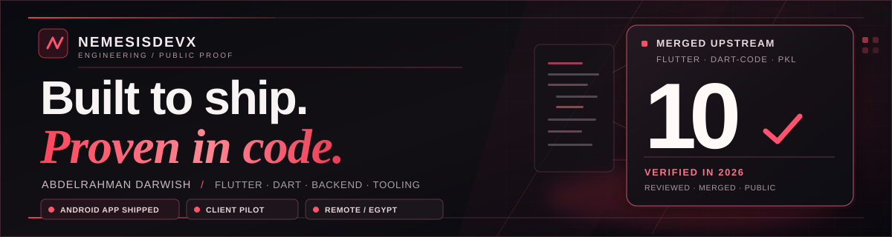

  

  <h1>Abdelrahman Darwish · NemesisDevX</h1>
  
<strong>Flutter / Dart · Developer Tooling · Backend Engineering</strong>

  
Independent developer in Egypt. <strong>10 engineering PRs merged upstream</strong> into Flutter, Dart-Code and Apple-maintained Pkl tooling. One published Android app. Real code, regression tests and external reviews.

  

    <a href="https://nemesisdevx.github.io/"><strong>PORTFOLIO ↗</strong></a> &nbsp;·&nbsp;
    <a href="https://nemesisdevx.github.io/work.html"><strong>CASE STUDIES ↗</strong></a> &nbsp;·&nbsp;
    <a href="https://nemesisdevx.github.io/assets/Abdelrahman_Darwish_Engineering_CV_2026.pdf"><strong>RESUME (PDF) ↗</strong></a> &nbsp;·&nbsp;
    <a href="https://play.google.com/store/apps/details?id=com.tasbehati.ai.pr"><strong>ANDROID APP ↗</strong></a> &nbsp;·&nbsp;
    <a href="mailto:abdelrhmanmahrous386@gmail.com"><strong>EMAIL ↗</strong></a>
  

  
Available for paid remote engineering roles and contracts. Open-source contributions do not imply employment with upstream organizations.

---

### Engineering highlights · Start here

**01 — [Flutter Web accessibility](https://github.com/flutter/flutter/pull/195564)** · Corrected slider semantics when a disabled control becomes enabled. Regression-tested and merged into Flutter Web Engine.

**02 — [Dart-Code DTD socket reliability](https://github.com/Dart-Code/Dart-Code/pull/6367)** · Settled hanging requests on disconnect/shutdown and guarded sends to non-open sockets, with verified regression tests. Merged by DanTup on 9 November 2026.

**03 — [Dart-Code DTD lifecycle](https://github.com/Dart-Code/Dart-Code/pull/6349)** · Fixed async callbacks firing after extension disposal, with focused regression coverage.

**04 — [Dart-Code Test Explorer](https://github.com/Dart-Code/Dart-Code/pull/6388)** · Corrected dynamic test/group matching so runtime nodes don't nest under unrelated outline nodes; added regressions. Merged after maintainer approval on 10 November 2026.

Ranked by engineering impact and test evidence — not merge date. Upstream contributions are not employment with the maintainers.

---

## Merged upstream

**10 verified merged upstream engineering PRs as of 11 November 2026 — ranked by engineering impact, not chronology.** Real bug fixes and regression tests accepted after upstream review. Every link points to the corresponding public code, discussion, and merge record; contributions do not imply employment by the projects or their parent organizations.

| Contribution (ranked) | Engineering impact | Merged upstream |
| :--- | :--- | :--- |
| **01 / Flutter Core / Web Engine** | Fixed initial accessibility value/range synchronization when a previously disabled slider becomes enabled; reviewer-validated regression coverage | [flutter/flutter #195564](https://github.com/flutter/flutter/pull/195564) |
| **02 / Dart-Code / DTD WebSocket reliability** | Settled pending requests on connection loss or shutdown; guarded writes to non-open sockets; added regressions for disconnect, disposal, and CONNECTING state | [Dart-Code #6367](https://github.com/Dart-Code/Dart-Code/pull/6367) |
| **03 / Dart-Code / DTD lifecycle** | Fixed async event and service callbacks that could run after VS Code extension disposal; added regression coverage and responded to maintainer review | [Dart-Code #6349](https://github.com/Dart-Code/Dart-Code/pull/6349) |
| **04 / Dart-Code / CI performance** | Replaced unnecessary real Dart/Flutter process and network launches in command tests with deterministic stubs; focused Flutter test group improved ~24s to ~3s locally, with DanTup review and approval | [Dart-Code #6373](https://github.com/Dart-Code/Dart-Code/pull/6373) |
| **05 / Dart-Code / Test Explorer correctness** | Matched dynamic Outline nodes only by kind and full name, preserving exact same-kind siblings with regression coverage | [Dart-Code #6388](https://github.com/Dart-Code/Dart-Code/pull/6388) |
| **06 / Dart-Code / VS Code** | Fixed hidden ancestor directories breaking Dart test filtering and `pubspec.yaml` handling | [Dart-Code #6301](https://github.com/Dart-Code/Dart-Code/pull/6301) |
| **07 / Apple / pkl-neovim** | Corrected nested Pkl language-server settings and added a headless Neovim regression harness | [apple/pkl-neovim #75](https://github.com/apple/pkl-neovim/pull/75) |
| **08 / Dart-Code / SDK discovery** | Added SDK search-precedence tests, including Flutter, Fuchsia, PATH, and Bazel fallback; removed obsolete `DART_PATH_OVERRIDE` handling | [Dart-Code #6337](https://github.com/Dart-Code/Dart-Code/pull/6337) |
| **09 / Dart-Code / Package testing** | Expanded automated coverage for package commands and `pubspec.yaml` update guards, with maintainer-requested test isolation | [Dart-Code #6332](https://github.com/Dart-Code/Dart-Code/pull/6332) |
| **10 / Dart-Code / Project creation** | Added 12 tests for `dart.createProject`, SDK configuration, cancellation and error paths | [Dart-Code #6324](https://github.com/Dart-Code/Dart-Code/pull/6324) |

The Apple contribution is to an Apple-maintained open-source repository, not a claim of employment or affiliation. AI assistance was disclosed where applicable, and links provide the independently reviewable engineering evidence.

<a href="https://nemesisdevx.github.io/"><strong>↗ Explore NEMESIS / Engineering</strong></a> &nbsp; · &nbsp; <a href="mailto:abdelrhmanmahrous386@gmail.com?subject=Remote%20engineering%20opportunity">Discuss a paid remote role or contract</a>

## Engineering case studies — five merged, one human-approved

| What broke | Fix & validation | Public proof |
| :--- | :--- | :--- |
| **Flutter Web accessibility (merged):** enabling a previously disabled slider could leave incorrect initial screen-reader value/range attributes. | Corrected the Web semantics initialization path, added regression coverage, and incorporated reviewer feedback. Merged **4 Nov 2026**. | [Flutter #195564 — merged diff & reviews](https://github.com/flutter/flutter/pull/195564) |
| **Dart-Code / DTD WebSocket reliability (merged):** pending calls could hang after socket closure, and sends could target non-OPEN sockets. | Settled abandoned requests; guarded socket state; covered CONNECTING, unexpected disconnect and shutdown with regressions. Merged by DanTup **9 Nov 2026**. | [Dart-Code #6367 — merged implementation](https://github.com/Dart-Code/Dart-Code/pull/6367) |
| **Dart-Code / DTD lifecycle (merged):** asynchronous device and service events could outlive VS Code extension disposal and trigger errors. | Added lifecycle guards and regression coverage for shutdown/disposal races, worked through maintainer reviews, and landed the fix on **5 Nov 2026**. | [Dart-Code #6349 — merged code & review](https://github.com/Dart-Code/Dart-Code/pull/6349) |
| **Dart-Code / CI reliability (merged):** tests spawned real Dart/Flutter tools and sometimes contacted the network simply to verify command invocation and output. | Replaced tool spawns with deterministic stubs, confirmed output assertions and tests; one focused Flutter group went from ~24s to ~3s locally. Maintainer DanTup approved the changes. Merged **7 Nov 2026**. | [Dart-Code #6373 — merged code and review](https://github.com/Dart-Code/Dart-Code/pull/6373) |
| **Dart-Code Test Explorer (merged):** runtime groups could nest under unrelated outline groups in VS Code's Test Explorer. | Matched dynamic nodes by kind and full name, kept exact siblings independent, and added regressions. Merged **10 Nov 2026** after review. | [Dart-Code #6388 — merged diff](https://github.com/Dart-Code/Dart-Code/pull/6388) |
| **Flutter Web scrolling semantics (human-approved; not merged):** after a scrollable list shrank, stale semantic DOM offsets made clicking the painted Row 4 activate Row 2. | Corrected stale offset handling and added regression checks. Reviewer `flutter-zl` independently verified the [before demo](https://flutter-demo-93-before.web.app) and [after demo](https://flutter-demo-93-after.web.app), then approved the PR. It is still open. | [Flutter #195578 — approval & diff](https://github.com/flutter/flutter/pull/195578) |

*Status snapshot: 11 November 2026. Flutter #195578 is **approved but not merged**. Dart-Code #6388, #6367 and #6349 **are merged**. Only independently verified upstream merges are counted; CI results, approvals and private client work are tracked separately.*

**My workflow:** reproduce a real failure → write a focused regression → fix the smallest safe path → run tests and static checks → address technical review. This is also how I work on production Flutter apps and backend APIs.

[**Explore NEMESIS / Engineering →**](https://nemesisdevx.github.io/) · [Detailed case studies](https://nemesisdevx.github.io/work.html#case-studies)

## Shipped software

### [Tasbehati / تسبيحاتي](https://play.google.com/store/apps/details?id=com.tasbehati.ai.pr)

A **published Flutter Android application** for Quran reading, adhkar, tasbih, prayer times, and daily spiritual tools. Built and maintained with practical experience in production debugging, Firebase, mobile release engineering, and monetization.

**Production evidence:** [Open Tasbehati on Google Play](https://play.google.com/store/apps/details?id=com.tasbehati.ai.pr) · Android production release · Source is private.

| Engineering strengths | Real-world scope |
| :--- | :--- |
| **Mobile delivery** | Android app release and ongoing maintenance |
| **Debugging & reliability** | Crash fixes, regression analysis, and UI behavior |
| **Integrations** | Firebase, REST APIs, and mobile ads |
| **Testing** | Focused regressions, release checks, and device validation |

## Focused upstream review queue

**Selected external PRs under review as of 11 November 2026.** This shortlist keeps open proposals separate from merged work. [View all open PRs](https://github.com/pulls?q=is%3Apr+author%3ANemesisDevX+is%3Aopen).

| Priority | Contribution | Current review signal |
| :--- | :--- | :--- |
| **01 · Human-approved** | [Flutter #195578](https://github.com/flutter/flutter/pull/195578) | Approved but not merged; upstream verification remains pending. |
| **02 · Human-approved** | [dart-lang/tools #2763](https://github.com/dart-lang/tools/pull/2763) | Approved but not merged. |
| **03 · Maintainer-gated CI** | [flutter/core-packages #49](https://github.com/flutter/core-packages/pull/49) | Multicast DNS interface fix and regression coverage; upstream CI approval pending. |
| **04 · Review in progress** | [dart-lang/tools #2824](https://github.com/dart-lang/tools/pull/2824) | YAML empty-value span fix; bot review, no confirmed human approval. |
| **05 · Maintainer-gated CI** | [dart-lang/tools #2802](https://github.com/dart-lang/tools/pull/2802) | MIME signatures; not merged. |
| **06 · Review in progress** | [dart-lang/tools #2807](https://github.com/dart-lang/tools/pull/2807) | CSS escaped quotes; not merged. |
| **07 · Review in progress** | [dart-lang/tools #2808](https://github.com/dart-lang/tools/pull/2808) | CSS media query recovery; not merged. |
| **08 · Awaiting re-review** | [Flutter DevTools #10057](https://github.com/flutter/devtools/pull/10057) | Feedback addressed; no confirmed final human acceptance. |

Other open proposals are deferred from the shortlist, not closed or deleted. Upstream maintainers control merges; approvals and passing CI are not merges.

## Selected engineering projects

| Project | Evidence and scope |
| :--- | :--- |
| **FamilyMove / family fitness (private client pilot)** | Bilingual Flutter Android + Laravel 13 / Filament 5; family accounts, verified exercise flows, notifications, participant activity history, consent-aware AI and PDF/XLSX reports; staged client review, not a public release | 
| **[VoiceOps Controller](https://github.com/NemesisDevX/VoiceOps-Controller)** | Python / FastAPI infrastructure control, human confirmation for actions and regression testing |
| **[voxguard / PauseSignal](https://github.com/NemesisDevX/voxguard)** | Flutter voice-scam risk prototype with family alerts; **experimental, not a validated detector** · [Demo](https://nemesisdevx.github.io/voxguard/) |
| **[Zero-Day AI Auditor](https://github.com/NemesisDevX/Zero-Day-AI-Auditor)** | Experimental Solidity checks with local Anvil simulations; **no claim of discovered zero-days** |

## Toolkit

  
  
  
  
  
  
  

**Especially interested in:** Flutter internals, accessibility, editor integrations, automated tests, Python APIs, CI reliability, and authorized security research.

## Let's work together

**Available for:** paid remote Flutter / Dart development, Android engineering, developer tooling, testing, Python APIs, Laravel backends, and focused contract projects. Based in **Egypt**.

| Contact | Direct link |
| :--- | :--- |
| **Email** | [abdelrhmanmahrous386@gmail.com](mailto:abdelrhmanmahrous386@gmail.com) |
| **Phone** | [+20 10 6747 5499](tel:+201067475499) |
| **WhatsApp** | [Chat on WhatsApp](https://wa.me/201067475499) |
| **Telegram** | [Chat by phone number](https://t.me/+201067475499) |
| **LinkedIn** | [Professional profile](https://www.linkedin.com/in/abdellrhman-darweish-0b6144433/) |

Telegram's phone-based chat link depends on whether my account allows discovery by phone number. For a reliable first contact, please use email or WhatsApp.

  

  
<strong>Less noise. More code. More reproducible evidence.</strong>

  
<a href="https://nemesisdevx.github.io/">NEMESIS / Engineering</a> · <a href="https://nemesisdevx.github.io/assets/Abdelrahman_Darwish_Engineering_CV_2026.pdf">Resume (PDF)</a> · <a href="https://nemesisdevx.github.io/portfolio.html">Detailed case studies</a> · <a href="mailto:abdelrhmanmahrous386@gmail.com">Email me</a> · <a href="https://wa.me/201067475499">WhatsApp</a>

