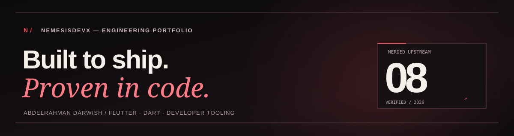

<div align="center">
  

  <p><samp>INDEPENDENT BUILDER // 3 VERIFIED UPSTREAM MERGES // NEMESISDEVX</samp></p>

  <p>
    <a href="https://github.com/NemesisDevX?tab=repositories"><strong>[ EXPLORE CODE ]</strong></a> &nbsp; / &nbsp;
    <a href="https://nemesisdevx.github.io/"><strong>[ PORTFOLIO ]</strong></a> &nbsp; / &nbsp;
    <a href="https://github.com/Dart-Code/Dart-Code/pull/6301"><strong>[ MERGED #6301 ]</strong></a> &nbsp; / &nbsp;
    <a href="https://github.com/Dart-Code/Dart-Code/pull/6324"><strong>[ MERGED #6324 ]</strong></a> &nbsp; / &nbsp;
    <a href="https://github.com/apple/pkl-neovim/pull/75"><strong>[ APPLE PKL #75 MERGED ]</strong></a>
  </p>

  <p>
    <code>Flutter</code> <code>Dart</code> <code>Python</code> <code>FastAPI</code> <code>Systems</code> <code>Security</code>
  </p>
</div>

---

### `01 / SIGNAL`

> **Building what others won't.**  
> Flutter. Dart. Systems. Security.  
> **Less noise. More code.**

I work across application engineering, developer tooling, backend systems, and security research prototypes. I care about reproducible bugs, focused fixes, test evidence, and the parts of software that break at the edges.

### `02 / MERGED INTO UPSTREAM`

**3 merged, independently reviewed contributions** across the official Dart-Code and Apple Pkl Neovim open-source repositories. Each link opens the upstream PR, code review, and merge record.

**[Dart-Code / Dart-Code — PR #6301](https://github.com/Dart-Code/Dart-Code/pull/6301)**  
`Fix hidden ancestor directories breaking test filters and pubspec handling`

Merged into the official **Dart & Flutter VS Code extension** repository by [DanTup](https://github.com/DanTup) on **October 31, 2026**. The change addresses test discovery and project configuration handling for hidden ancestor directories.

[**VIEW THE MERGED PULL REQUEST**](https://github.com/Dart-Code/Dart-Code/pull/6301)

**[Dart-Code / Dart-Code — PR #6324](https://github.com/Dart-Code/Dart-Code/pull/6324)**  
`Add test coverage for the dart.createProject command`

Merged into the official **Dart & Flutter VS Code extension** repository on **November 2, 2026**. Added **12 focused tests** for Dart project creation, including template-fetch failures, input validation, cancellation paths, folder handling, and SDK settings. Improved `ChildProcessSpawnStub` test support; addressed review feedback from [DanTup](https://github.com/DanTup) and DanTupBot. AI-assisted engineering was disclosed in the PR.

[**VIEW THE SECOND MERGED PULL REQUEST**](https://github.com/Dart-Code/Dart-Code/pull/6324)

**[Apple / pkl-neovim — PR #75](https://github.com/apple/pkl-neovim/pull/75)**  
`Send LSP settings as a nested table`

Merged into the official **apple/pkl-neovim** open-source repository on **November 3, 2026**. Fixed Pkl language-server configuration reaching Neovim as `null` by using nested settings for `workspace/configuration`. Added a headless Neovim regression test, `make test`, and GitHub Actions CI coverage after maintainer review. The PR was reviewed and **approved** by [bioball](https://github.com/bioball), with the final [LGTM review](https://github.com/apple/pkl-neovim/pull/75#pullrequestreview-5758297668) after the requested `tests/` structure, `make test`, and CI improvements were implemented. This is an upstream open-source contribution, **not Apple employment**. AI assistance was disclosed in the PR.

[**VIEW THE THIRD MERGED PULL REQUEST**](https://github.com/apple/pkl-neovim/pull/75)

### `03 / SHIPPED TO PRODUCTION`

**[TASBEHATI / تسبيحاتي — Android on Google Play](https://play.google.com/store/apps/details?id=com.tasbehati.ai.pr)**  
`Flutter` · `Android` · `Production release` · `Private source`

A real-world Flutter Android app for tasbih, daily adhkar, Quran reading, prayer times, and AI-assisted spiritual guidance. Developed and shipped for Google Play distribution, with hands-on release management and mobile monetization work.

**PUBLIC PRODUCT // PRIVATE CODE** — [**VIEW ON GOOGLE PLAY**](https://play.google.com/store/apps/details?id=com.tasbehati.ai.pr)

### `04 / OPEN SOURCE // REVIEW QUEUE`

These are **submitted contributions**, **not merged claims**. The pull request links show their live status.

**Human review approved (Nov 2–3, 2026; not yet merged):** Flutter web accessibility [#195564](https://github.com/flutter/flutter/pull/195564#pullrequestreview-5758632957) and [#195578](https://github.com/flutter/flutter/pull/195578#pullrequestreview-5758459257) by [flutter-zl](https://github.com/flutter-zl), and Dart [package:pool #2763](https://github.com/dart-lang/tools/pull/2763) by [sigurdm](https://github.com/sigurdm). Approvals are distinct from merging; CI and maintainer gates may still apply.

| Upstream project | Contribution | Pull request |
| :--- | :--- | :--- |
| **Flutter Engine** | **Approved review (unmerged)** — Web slider accessibility: synchronize semantics when enabled | [#195564](https://github.com/flutter/flutter/pull/195564) |
| **Flutter Engine** | **Approved review (unmerged)** — Reset stale web scroll semantics offsets after content shrinks | [#195578](https://github.com/flutter/flutter/pull/195578) |
| **Flutter DevTools** | Responsive Network toolbar and status footer | [#10057](https://github.com/flutter/devtools/pull/10057) |
| **Flutter DevTools** | Reduce extension build size with conservative asset pruning | [#10063](https://github.com/flutter/devtools/pull/10063) |
| **Dart packages** | **Approved review (unmerged)** — Restore repeated timeout behavior in `pool` | [#2763](https://github.com/dart-lang/tools/pull/2763) |

### `05 / BUILT IN THE SHADOWS`

| Project | Engineering focus |
| :--- | :--- |
| **[voxguard / PauseSignal](https://github.com/NemesisDevX/voxguard)** | Flutter/Dart prototype for multi-signal voice scam *risk indicators*, incident reporting, and family alerts. [Live demo](https://nemesisdevx.github.io/voxguard/). Not a validated forensic detector. |
| **[VoiceOps Controller](https://github.com/NemesisDevX/VoiceOps-Controller)** | Python/FastAPI voice-controlled infrastructure tooling with explicit human confirmation before changes, telemetry, and test coverage. |
| **[Zero-Day AI Auditor](https://github.com/NemesisDevX/Zero-Day-AI-Auditor)** | Solidity security research prototype using heuristic analysis and controlled exploit simulation on a local Anvil EVM. Not a claim of discovered zero-days. |

### `06 / TOOLCHAIN`

```text
LANGUAGES      Dart / Python / TypeScript / PHP
ENGINEERING    Flutter / FastAPI / Laravel / REST APIs
INFRASTRUCTURE Git / GitHub / CI / Firebase / Docker
INTERESTS      Web-engine internals / accessibility / automation / security research
```

<div align="center">
  <p><samp>NO HYPE // TRACE THE ISSUE // READ THE DIFF // VERIFY THE TESTS</samp></p>
  <p>
    <a href="https://github.com/NemesisDevX">GITHUB</a> &nbsp; / &nbsp;
    <a href="https://nemesisdevx.github.io/">WEB</a> &nbsp; / &nbsp;
    <a href="https://www.linkedin.com/in/abdellrhman-darweish-0b6144433/">LINKEDIN</a>
  </p>
  <sub>Independent work and contributions. All upstream PR links are provided for direct verification.</sub>
</div>
